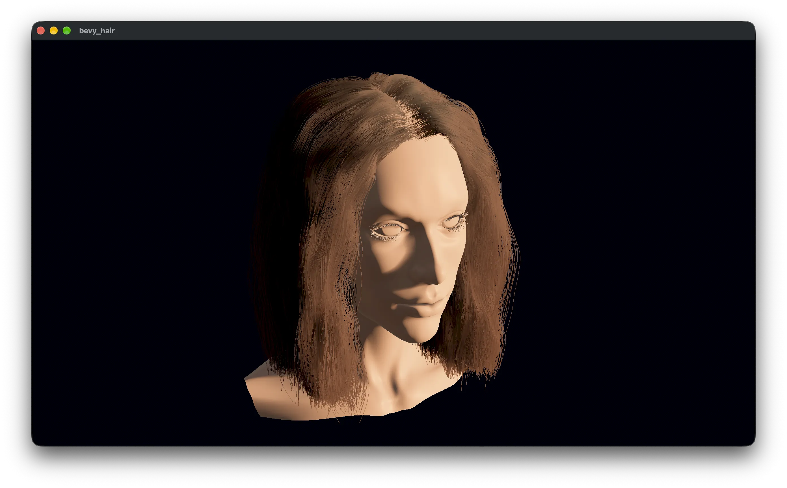

# bevy_hair



Real-time strand hair with deferred software rasterization on hair meshes.

The renderer is a Bevy 0.20 plugin. This branch builds against the `m/shadow-factors` Bevy fork for per-light material shadow channels. It bakes explicit strands into layered hair-mesh bundles, generates strands in a subgroup compute shader, and rasterizes them into a 64-bit atomic G-buffer. Shading evaluates Karis's fit of the Marschner R, TT, and TRT lobes for every clustered light, with Bevy shadow maps. The groom albedo is the multiple-scattered hair color, mapped to fiber absorption with Chiang et al.'s inversion. Multiple scattering uses Zinke et al.'s dual scattering: local backscattering on every light, and global forward scattering through the strands a 16-layer deep opacity map counts toward the key directional. The camera environment map supplies one prefiltered lookup along the tilted R cone, shared by R and TRT, and an irradiance lookup for scattering. A reconnection filter reconstructs coverage.

Hair can shadow other surfaces. `HairShadowMaterial` is a `StandardMaterial` that hair shadows. Every directional, point, and spot light with a `MaterialShadowChannel` gets its own deep opacity map, and the material attenuates each light by the strands between the surface and that light. Give each light its own channel, up to four, and build the extension with `HairShadow::receiver()`. The example's head uses it, with the key, fill, and rim on channels 0 to 2. The maps are the previous frame's, so a moving light lags its hair shadow by a frame.

Native wgpu is required. The example requests subgroup operations and 64-bit atomic min/max (`SHADER_INT64`, `SHADER_INT64_ATOMIC_MIN_MAX`). That combination is available on Metal (Apple9, or Apple8 with Mac2), Vulkan, and DX12. Browser WebGPU is out of scope.

## Run the example

```text
cargo run --example groom
```

`cargo run --example bake` writes the three grooms to `target/groom-cache/` without opening a window. The viewer bakes any missing groom on first launch, then loads the cache until a hair file or the baker changes.

| Key | Action |
| --- | --- |
| right-drag | look around |
| WASD / Q E | move, and rise or fall |
| scroll | change fly speed |
| shift | move faster |
| 1 / 2 / 3 | straight, wavy, curly |
| L | level of detail |
| F | reconnection filter |
| O | ambient occlusion |
| M | deep opacity map |
| `[` / `]` | lambda (default 3) |
| K | studio or environment-sun lighting |
| space | spin the environment (and the sun outside the studio) |

## Hair models

The example uses Cem Yuksel’s woman grooms and the matching head mesh by Murat Afshar:

<https://www.cemyuksel.com/research/hairmodels>

Those files live in `assets/hair/`. Public material that shows them should link that page.

## Reference

Lipp, Jarabo, Wimmer, and Bode (2026). *Deferred Software Rasterization for Efficient Real-time Hair Rendering.* Proceedings of the ACM on Computer Graphics and Interactive Techniques, 9(4).

<https://arxiv.org/abs/2607.04230>

<https://doi.org/10.1145/3820015>
